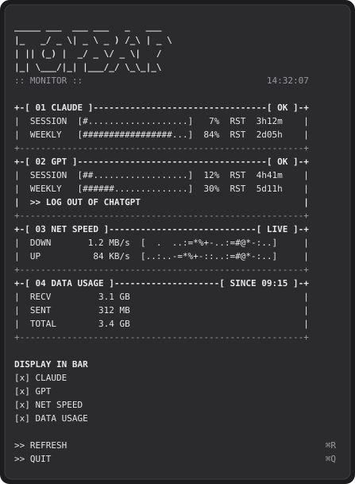
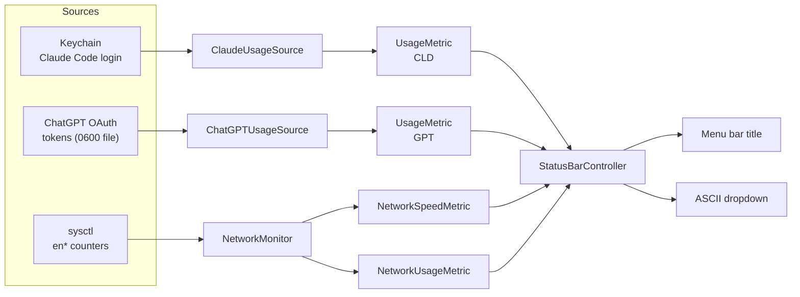

# Topbar Monitor

**A minimal ASCII monitor in the macOS menu bar for Claude and ChatGPT plan usage plus live network traffic.**

[](https://github.com/michalilski/topbar-monitor/actions/workflows/ci.yml)


[](LICENSE)

<p align="center">
  
</p>

## Why

If you use Claude Code and ChatGPT/Codex heavily, you keep running into rate limits without warning. Topbar Monitor puts your session and weekly limits for both, plus your current network throughput, in the menu bar where you can always see them. It is a single native binary with no dependencies, no third-party services and no telemetry. It only talks to the providers you are already signed in to.

## Features

- **Claude usage**: 5-hour session and weekly utilization, read with your existing Claude Code login. No extra sign-in.
- **ChatGPT usage**: session and weekly limits via a built-in browser sign-in (OAuth PKCE), with automatic token refresh.
- **Network speed**: live download/upload rates for physical (`en*`) interfaces, with ASCII sparklines of the last minute.
- **Data usage**: bytes received and sent since the app started.
- **Alerts**: values turn orange at 80% usage.
- **Configurable bar**: choose which metrics appear in the menu bar. Your choice is remembered.
- **Retro ASCII UI**: monospaced boxes, progress bars and reset countdowns in the dropdown.
- **Lightweight**: no Dock icon, no dependencies, polls usage every 2 minutes and network every second.

## Screenshots

<table>
  <tr>
    <td valign="top"></td>
    <td valign="top">

**Menu bar**

| Segment | Meaning |
|---|---|
| `CLD S` / `W` | Claude session (5h) / weekly usage |
| `GPT S` / `W` | ChatGPT session / weekly usage |
| `DN` / `UP` | Current download / upload per second |
| `DATA` | Data received + sent since launch |

**Dropdown**

- `RST` shows the time until each window resets.
- `>> LOG IN TO CHATGPT` / `>> LOG OUT OF CHATGPT` manages the ChatGPT session.
- `DISPLAY IN BAR` toggles each metric.
- `>> REFRESH` (`⌘R`) and `>> QUIT` (`⌘Q`).

</td>
  </tr>
</table>

<sub>Mockups generated from the app's own layout code. Values are illustrative.</sub>

## Architecture



Each metric implements a small `Metric` protocol (what to render). Anything that polls implements `Refreshable` (how often to update). `StatusBarController` schedules the refreshers and re-renders the bar. See [docs/architecture.md](docs/architecture.md) for the component, refresh and sign-in flows.

## Tech stack

- **Swift 5.10** with Swift Package Manager. No third-party dependencies.
- **AppKit** (`NSStatusItem`, `NSMenu`) for the menu bar UI
- **Network.framework** for the one-shot OAuth loopback callback server
- **CryptoKit** for PKCE (S256)
- **Darwin `sysctl`** for interface byte counters
- **Swift Testing** for unit tests
- **GitHub Actions** CI on macOS

## Getting started

### Prerequisites

- macOS 14 (Sonoma) or later
- Xcode 16 or the Swift 5.10+ toolchain (`xcode-select --install`)
- For Claude metrics: [Claude Code](https://docs.anthropic.com/en/docs/claude-code) signed in with a Claude subscription (`claude` → `/login`)
- For ChatGPT metrics: a ChatGPT account with a plan that has Codex usage limits

### Install

```bash
git clone https://github.com/michalilski/topbar-monitor.git
cd topbar-monitor
make install
```

`make install` builds a release `.app`, signs it ad-hoc, copies it to `/Applications` and registers a LaunchAgent (`~/Library/LaunchAgents/com.michalilski.topbar-monitor.plist`) that starts it at login. To install somewhere else, set `INSTALL_DIR`, for example `INSTALL_DIR=~/Applications make install`.

To remove it:

```bash
make uninstall                    # remove the app and the LaunchAgent
./scripts/uninstall.sh --purge    # also delete stored ChatGPT tokens and preferences
```

### Run without installing

```bash
make run       # builds build/TopbarMonitor.app and opens it
```

### Configure

There is no config file. Everything is set from the dropdown:

1. **Claude** works automatically if Claude Code is signed in. If the section shows `SIGNED OUT`, run `claude` and `/login`.
2. **ChatGPT**: click the bar, then `>> LOG IN TO CHATGPT`, and finish signing in in your browser. Tokens are saved to `~/Library/Application Support/TopbarMonitor/chatgpt-auth.json` with `0600` permissions.
3. **Bar contents**: use `DISPLAY IN BAR` to show or hide each metric.

### Development

| Command | What it does |
|---|---|
| `make build` | Debug build (`swift build`) |
| `make test` | Run unit tests (`swift test`) |
| `make app` | Build the release app bundle into `build/` |
| `make run` | Build and open the app |
| `make install` / `make uninstall` | Install or remove the app and LaunchAgent |
| `make clean` | Remove `.build/` and `build/` |

## Project structure

```
topbar-monitor/
├── Package.swift
├── Makefile
├── Resources/
│   └── Info.plist                 # LSUIElement app bundle metadata
├── Sources/
│   ├── TopbarMonitor/             # executable: app entry point
│   └── TopbarMonitorCore/
│       ├── MonitorFactory.swift   # wires metrics, sources and controller
│       ├── Metrics/               # Metric / Refreshable + implementations
│       ├── Usage/                 # Claude & ChatGPT usage sources, keychain, HTTP
│       ├── Auth/                  # ChatGPT OAuth PKCE, callback server, token store
│       ├── Network/               # sysctl interface counters, rate sampling
│       ├── Formatting/            # ASCII bars, sparklines, byte/duration formats
│       └── UI/                    # status item, menu builder, theme
├── Tests/TopbarMonitorCoreTests/  # parsers, auth, formatting, network
├── scripts/
│   ├── build-app.sh               # release build + .app bundle + ad-hoc signing
│   ├── install.sh                 # install to /Applications + LaunchAgent
│   └── uninstall.sh
└── docs/
    ├── architecture.md
    └── images/                    # SVG mockups
```

## Privacy and security

- No analytics, telemetry or third-party servers. The app only contacts `api.anthropic.com`, `auth.openai.com` and `chatgpt.com`.
- The Claude token is read from the keychain on each refresh and never written to disk by this app.
- ChatGPT tokens are stored in a file only your user can read (`0600`). Delete them with `>> LOG OUT OF CHATGPT` or `./scripts/uninstall.sh --purge`.
- The OAuth callback listener binds to `127.0.0.1:1455` only while you sign in, validates `state` and shuts down after one request or 5 minutes.

## Limitations

- The usage endpoints are undocumented and may change without notice.
- The app is ad-hoc signed, not notarized. Build it from source as shown above.
- Network totals reset when the app restarts.

## License

[MIT](LICENSE) © 2026 Michał Ilski
