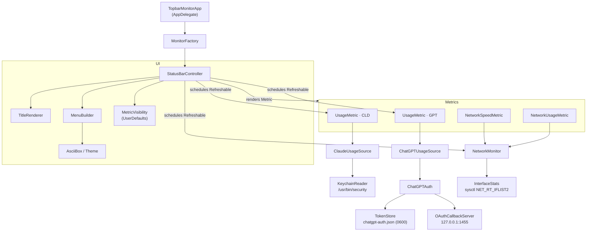
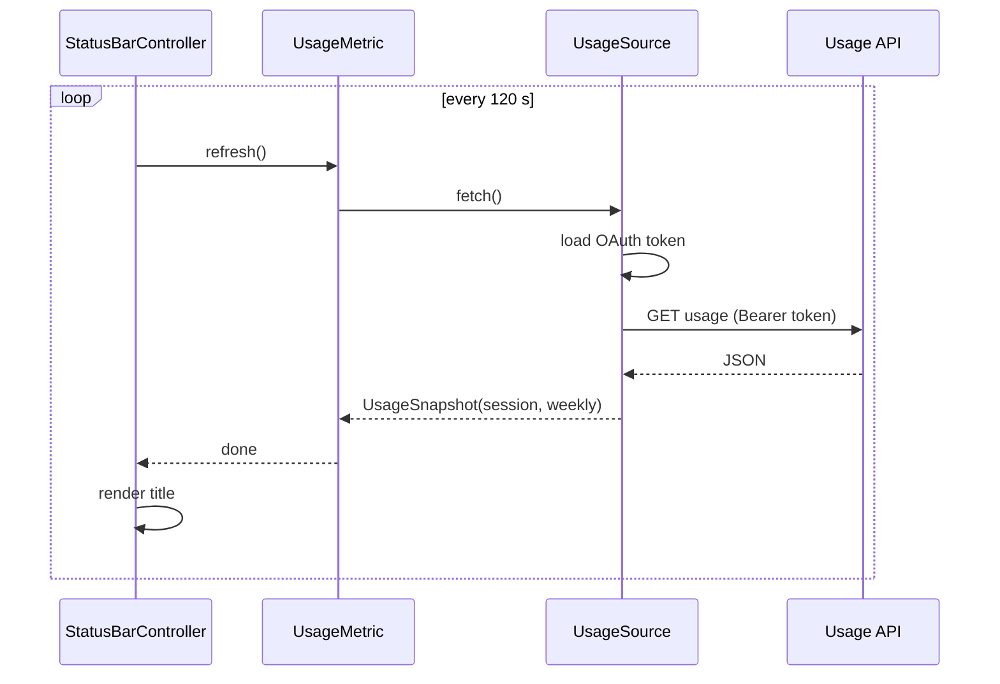
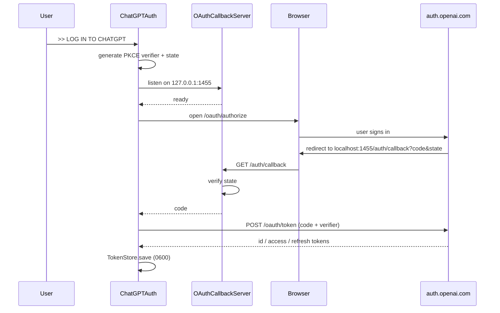

# Architecture

Topbar Monitor is a single Swift package with two targets:

- **`TopbarMonitor`** is a tiny executable. It starts `NSApplication` as an accessory app (no Dock icon) and hands control to the `StatusBarController`.
- **`TopbarMonitorCore`** is a library with all the logic, so it can be unit-tested without launching the UI.

## Components

### Two protocols

| Protocol | Responsibility | Implemented by |
|---|---|---|
| `Metric` | What to show: bar segments, detail lines, status, menu actions | `UsageMetric`, `NetworkSpeedMetric`, `NetworkUsageMetric` |
| `Refreshable` | How often and how to update state | `UsageMetric` (every 120 s), `NetworkMonitor` (every 1 s) |

`StatusBarController` runs one async loop per `Refreshable` and re-renders the bar title after each refresh. The dropdown menu is rebuilt lazily in `menuNeedsUpdate`, so it always shows fresh values when opened.

Adding a new metric means implementing `Metric` (and optionally `Refreshable`) and registering it in `MonitorFactory`.

## Usage refresh

- **Claude**: the access token is read from the `Claude Code-credentials` keychain item through `/usr/bin/security`, which Claude Code already trusts, so the app never triggers a keychain prompt. It calls `https://api.anthropic.com/api/oauth/usage` and reads the `five_hour` and `seven_day` windows.
- **ChatGPT**: tokens come from the in-app sign-in (see below). Expired access tokens are refreshed automatically 5 minutes before they expire. The app calls `https://chatgpt.com/backend-api/wham/usage` and reads the `primary_window` and `secondary_window` rate limits.

Both endpoints are undocumented and may change. Failures show up as a status label such as `SIGNED OUT`, `HTTP 401` or `BAD DATA` instead of crashing.

## ChatGPT sign-in

This is the same public OAuth PKCE flow the Codex CLI uses. The callback listener binds to loopback only, accepts one request, checks the `state` parameter and times out after 5 minutes.

## Network counters

`InterfaceStats` reads 64-bit byte counters for every `en*` interface with `sysctl(NET_RT_IFLIST2)`. `NetworkMonitor` samples once per second, computes rates from the deltas, keeps a 60-sample history for the sparklines, and ignores counter resets (for example after a Wi-Fi reconnect).

## Local data

| What | Where |
|---|---|
| ChatGPT tokens | `~/Library/Application Support/TopbarMonitor/chatgpt-auth.json` (mode `0600`) |
| Bar visibility toggles | `UserDefaults` (`visible.<metric id>`) |
| Claude token | Read from the keychain on each refresh, never stored |
